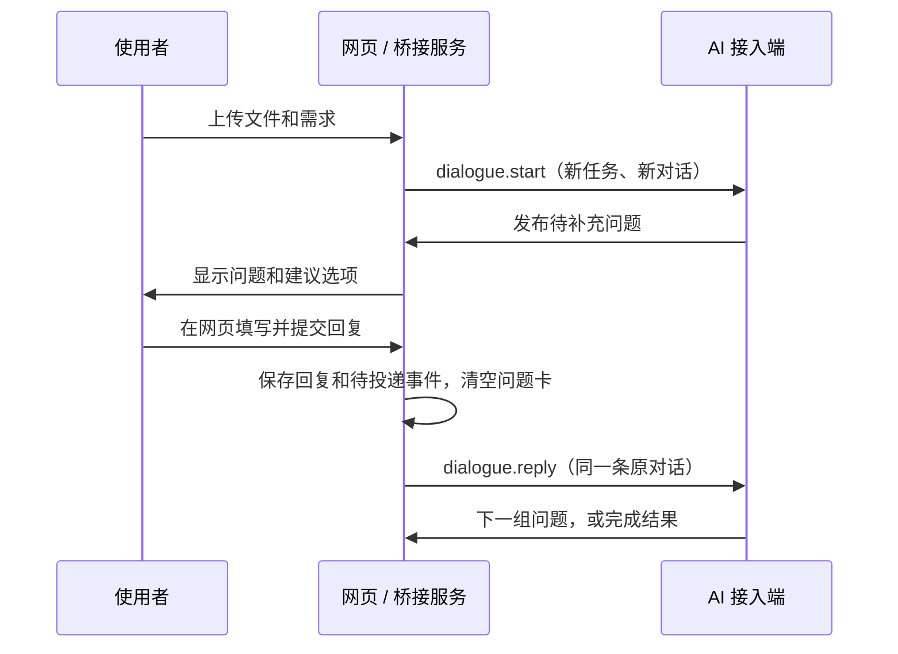

# Web AI Dialogue Bridge

把“上传数据 → AI 提问 → 网页回复 → 回调原 AI 对话继续处理”独立出来的轻量工具。

每次上传创建一个任务和一条对话，后续回复始终回到这条对话。一个任务可以包含多个文件和一段需求。网页回复保存后，待回复卡片立即清空；回调状态和回复记录仍可查看。



## 快速开始

需要 **Python 3.11 或更新版本**。运行时只使用标准库，**无需 `pip install`**。

```bash
git clone https://github.com/liaoqq123/web-ai-dialogue-bridge.git
cd web-ai-dialogue-bridge
python bridge.py init
python bridge.py start --open
```

Windows 也可以双击 `start.bat` 启动、`stop.bat` 关闭。后台启动不会保留命令行窗口；前台查看运行情况可使用 `python bridge.py serve`。

默认地址为 `http://127.0.0.1:8765`。使用启动时输出的**完整带凭据链接**打开，或再次执行：

```bash
python bridge.py url
```

默认是 `demo` 演示模式，**没有连接真实 AI**。上传一个文件或填写需求，网页会出现示例问题；回复后自动展示演示完成结果。它用于验证上传、网页回复、持久化和回调链路，不会替你分析文件。

关闭服务：

```bash
python bridge.py stop
```

修改监听地址、端口或适配器后，需要先关闭旧服务，再重新启动；`start` 发现同一数据目录的服务已运行时会复用它。

## 连接真实 AI

### 方式一：通用 Webhook

你提供一个接收回调的服务，由它调用自己的 AI 或对话系统。桥接器不绑定某一家模型服务，也不要求模型 API Key。

1. 将 `examples/webhook.config.json` 复制为 `webhook.local.json`。
2. 填写 `callback_url` 和接收端使用的 `callback_token`。
3. 关闭旧服务，然后运行：

```bash
python bridge.py serve --config webhook.local.json
```

只想试读示例配置时，也可以使用 `python bridge.py serve --config examples/webhook.config.json`，但示例地址没有附带运行中的接收服务。

桥接器会向该地址发送两类事件：

| 事件 | 接收端应做什么 |
| --- | --- |
| `dialogue.start` | 为这一个任务创建新对话，返回真实 `thread_id`。 |
| `dialogue.reply` | 将网页回复发送到任务已绑定的原 `thread_id`，返回同一编号。 |

接收端应按 `Idempotency-Key` 持久化去重，接收成功返回：

```json
{"accepted": true, "thread_id": "your-thread-id"}
```

接收端拿到任务后，通过独立的 **worker API** 发布问题、读取上传文件或提交完成结果。`callback_token` 用来验证桥接器发出的回调；`worker_token` 用来访问桥接器的工作端接口，两者用途不同。工作端凭据需由服务管理员单独配置给接收端，不会放在回调载荷或网页里。

完整接口、请求示例和失败回执见 [docs/protocol.md](docs/protocol.md)。

### 方式二：本机 Codex 桌面项目

`codex-desktop` 适配器调用正在运行的 **Windows Codex 桌面客户端**，在指定本地项目中新建任务对话，网页回复后继续原对话。它不另起独立的对话服务器。

这是从本地集成中抽取的**实验性桌面协议**，并非稳定的公开桌面 SDK。客户端版本、管道或项目身份变化可能使接入不可用；通用接入可使用 Webhook。测试覆盖协议处理和项目绑定，未把自动化测试声称为真实 AI 任务验收。

先在 Codex 中打开目标本地项目。将 `examples/desktop-binding.example.json` 复制为 `desktop-binding.local.json`，填写当前项目 ID、现有项目绝对目录、调用方对话 ID 和当前桌面工具管道。不要使用示例占位值。

```bash
python bridge.py stop
python bridge.py bind-desktop --binding-file desktop-binding.local.json
python bridge.py check
python bridge.py start --open
```

第一次接入且服务未启动时可跳过 `stop`。`bind-desktop` 和 `check` 只核对客户端及项目归属，**不会创建任务对话**；实际网页上传才会创建。

如果运行命令的 Codex 宿主已提供 `CODEX_THREAD_ID` 和 `CODEX_APP_TOOLS_PIPE_PATH`，也可通过参数绑定：

```bash
python bridge.py bind-desktop --project-dir "C:/projects/my-app" --project-id YOUR_LOCAL_PROJECT_ID
```

项目 ID 必须是客户端中已存在的本地项目。普通终端通常没有上述环境变量，需要提供完整本地绑定文件，或显式填写 `--caller-thread-id`、`--pipe`。

绑定文件和凭据仅保存在本机，不应上传 GitHub。适配器会核对项目目录、执行主机和原对话归属；不符合时停止投递，不会把回复改送到另一条对话。

## AI 怎样在网页提问

本机工作端可直接使用 CLI，它从本地数据目录读取 worker 凭据，不需要把凭据复制进命令行：

```bash
python bridge.py tasks
python bridge.py task --task-id TASK_ID
python bridge.py publish-questions --task-id TASK_ID --file examples/questions.json
python bridge.py complete --task-id TASK_ID --file examples/result.json
```

`TASK_ID` 替换为任务的真实编号。问题文件必须是 `{"questions": [...]}`；完成文件直接填写结果对象，例如 `{"summary":"处理结果"}`。AI 发布问题成功后结束当前轮，等待网页回复；不需要持续轮询。

不使用默认数据目录时，所有命令要带同一个前置参数：

```bash
python bridge.py --data-dir /path/to/local-state task --task-id TASK_ID
```

网页回复用于补充需求，**不等同于执行计划的批准**。桥接器不包含业务解析器、文件改写授权或生产发布流程；这些应由接入项目自己的规则处理。

## 内网访问

在服务所在机器监听所有 IPv4 网卡：

```bash
python bridge.py stop
python bridge.py start --host 0.0.0.0 --port 8765
python bridge.py url --host 192.0.2.10
```

最后一行的 `192.0.2.10` 是文档示例地址，需换成**服务所在机器的实际内网 IPv4**。将输出的完整链接发给使用者，并按需允许操作系统防火墙的该端口。`0.0.0.0` 是监听地址，不是访问地址。

服务会校验 `Host` 和同源请求。如果使用额外主机名，可在本地配置中添加 `"allowed_hosts": ["bridge-host"]`。`url --host` 只改变输出链接，不会更改监听或允许列表。

这是自部署 HTTP 工具，不是现成的公网 SaaS。需要公网访问时，由部署方配置 HTTPS 反向代理和访问控制。当前后端严格核对本地 `Host` 端口及 `Origin`；反代须正确映射这两项，不会自动信任 `X-Forwarded-*`。

## 凭据、数据和投递状态

- **网页凭据**：完整链接的 `#token=...`。页面读取后清除地址栏中的 fragment，放入当前标签页的 `sessionStorage`，通过 `Authorization: Bearer ...` 调用网页 API。
- **工作端凭据**：只用于 `/api/worker/`；网页凭据不能发布 AI 问题、提交完成结果或补录回调回执。
- **共享访问范围**：同一网页凭据可以查看这一实例的所有任务。当前没有账号系统或多用户任务隔离。
- **本地数据**：默认保存在 `.bridge/`，包括配置、随机凭据、SQLite 状态、上传文件、日志和桌面绑定。该目录已被 `.gitignore` 排除；自定义数据目录也应放在仓库外或自行加入忽略规则。
- **幂等**：重复提交相同 `request_key` 和相同内容复用原任务或回复；同一个键改内容返回冲突。回复与待投递事件在同一个数据库事务中保存。
- **失败处理**：明确未投递的 `failed` 事件可在网页重试；`unknown` 表示可能已经送达，禁止直接重放。服务在投递过程中重启，也会将该事件转为 `unknown`，避免多开对话或重复回复。

`unknown` 需要管理员核对**原动作**后，使用完整的真实回执补录，命令不会重新发送：

```bash
python bridge.py resolve-event --task-id TASK_ID --event-id EVENT_ID --file receipt.local.json
```

回执须包含核实后的 `thread_id`、`adapter` 及对应接入端绑定字段；不能拿任意新对话替代原对话。字段说明见协议文档。

## 项目结构

```text
bridge.py                    启动、关闭、本地 worker CLI
dialogue_bridge/
  server.py                  HTTP、上传和角色隔离
  store.py                   SQLite 任务、问题、回复、投递队列
  runtime.py                 单实例锁和回调调度
  adapters.py                demo / webhook / codex-desktop
  desktop.py                 本地桌面协议、项目与原对话校验
  config.py                  本地配置和随机凭据
  web/                       网页，无外部脚本或样式依赖
examples/                    不含真实凭据的输入示例
docs/protocol.md             API 与回调约定
tests/                       事务、HTTP、CLI、适配器和网页交互测试
```

运行测试：

```bash
python -m unittest discover -s tests -v
```

网页脚本交互测试额外需要 Node.js，但不需要 npm 包；未安装 Node.js 时仅跳过该项。MIT 许可见 [LICENSE](LICENSE)。
